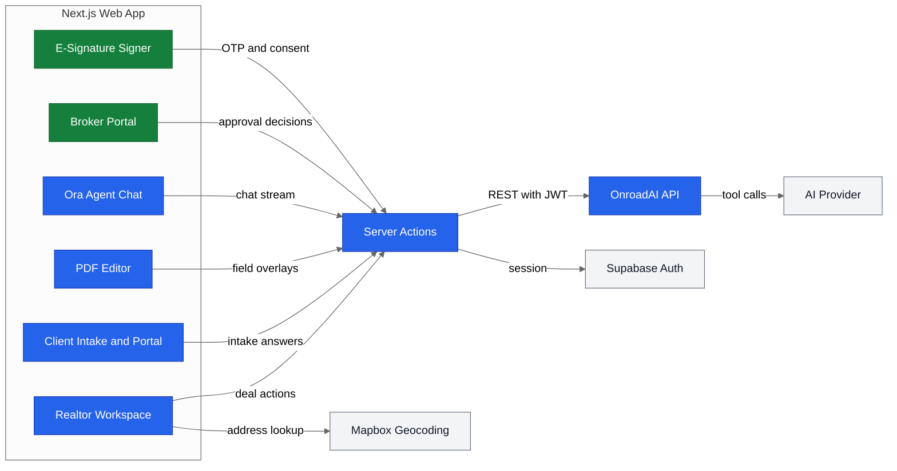

<p align="center"></p>

# OnroadAI

**A real estate transaction platform where realtors, brokers, and clients run deals, forms, and e-signatures in one place.**

    

OnroadAI is a real estate transaction execution platform for realtors, brokers, landlords, and clients. It turns a deal from first conversation to fully signed paperwork inside one workspace, and it has executed $90K worth of residential lease transactions. This repository contains the Next.js web application; the API lives in [onroad-express](https://github.com/risingOnIP/onroad-express).

## Overview

OnroadAI gives each party in a transaction its own workspace. Realtors open deals, collect client information once through dynamic intake forms, and generate every required contract from that data. Brokers review and approve agent submissions before anything goes out, and clients complete intake and sign documents from a secure link.

- **Canonical data model:** a shared schema standardizes more than 1,000 fields across dozens of Texas real estate forms, so one answer fills every form that needs it.
- **Rules-driven intake:** JSON-defined schema items and rule sets decide which forms a deal requires and render intake forms dynamically, including conditional visibility and validation.
- **In-browser PDF editor:** realtors place text, checkbox, and signature fields on any PDF with coordinate-based overlays, then export a filled document.
- **UETA-compliant e-signature:** signers verify by email one-time passcode, give explicit electronic signature consent, and every action is recorded in an audit trail.
- **Ora, the AI agent:** an LLM agent with tool calling creates deals, adds forms, fills fields, and sends documents for signature from natural language requests.
- **Deal management and CRM:** deals, parties, stages, reusable templates, and a transaction-aware client list live in one workspace.
- **Broker portal:** brokers tether agents to their brokerage, review submitted forms, and approve or return them for revision.

## Business Case

### The Problem

A single residential transaction involves a stack of state-mandated forms, each asking for the same names, addresses, dates, and terms in a slightly different layout. Agents retype that information by hand, chase clients for missing details over email, and route PDFs through separate e-signature and compliance tools. Preparing one lease or purchase package takes hours, and every manual copy is a chance for an error that delays closing or exposes the brokerage to compliance risk.

### Who It Serves

- **Realtors:** open a deal, send intake forms, and generate a complete, pre-filled contract package in one place.
- **Brokers:** oversee every tethered agent's deals and approve forms before they reach clients.
- **Landlords and clients:** answer intake questions once and review and sign documents from any device.
- **Brokerages:** standardize paperwork across agents with shared templates and a consistent audit trail.

### The Outcome

- Contract preparation drops from about 10 hours to under 1 hour per deal, because the agent drafts from natural language and intake answers flow into every form automatically.
- Client data is entered once and reused across every form in the deal, which removes retyping errors.
- Broker review, signing, and the audit trail happen inside the same platform, so a deal moves from intake to fully executed documents without leaving the workspace.
- The platform has executed $90K worth of residential lease transactions.

## How It Works

Each role works in its own workspace; Next.js Server Actions call the OnroadAI API, which owns the schemas, rules, documents, signatures, and the AI agent.



1. **Sign in:** `middleware.ts` and `utils/supabase/` refresh the Supabase session and route each user to the realtor, broker, or client workspace.
2. **Open a deal:** the realtor creates a deal in `app/(routes)/(workflow)/realtor/workspace/`, with Mapbox address lookup, and the API's rule set (typed in `components/files/types/realtor.ts`) attaches the required forms.
3. **Collect intake:** schema items render as dynamic fields through `components/files/realtor/fields/FieldRenderer.tsx`, and clients answer from `app/(routes)/client-intake/[intakeid]/` after email verification.
4. **Fill and place fields:** intake answers map onto canonical fields across every form, and `components/files/realtor/HybridPDFFormEditor.tsx` with `utils/pdf/pdfFieldGenerator.ts` places overlays by page coordinates using pdf-lib.
5. **Broker review:** brokers approve or return each form in `app/(routes)/(workflow)/broker/review-forms/`.
6. **Sign:** signers verify by email passcode, accept the electronic signature consent, and sign in `app/(routes)/signatures/signer/[signatureCollectionId]/`, with each step logged as a signature event.
7. **Ask Ora:** `app/actions/ai/chat-actions.ts` streams agent responses from the API, and `components/ai/` renders tool progress and results such as drafted forms and created deals.

## Tech Stack

| Layer | Technology | Purpose |
|---|---|---|
| Frontend | Next.js 15 (App Router), React 19 | Role-based workspaces, Server Actions, and route middleware |
| Frontend | Tailwind CSS 4, Radix UI, shadcn/ui, Framer Motion | Component library, layout, and motion |
| Client | pdf-lib, pdf.js (react-pdf), Fabric.js | PDF rendering, coordinate-based field overlays, and export |
| Client | Zustand, React Hook Form, Zod, dnd-kit | Editor state, form handling, validation, and drag-and-drop ordering |
| Data | Supabase (PostgreSQL, Auth) | Authentication, sessions, and chat history tables |
| Backend | [onroad-express](https://github.com/risingOnIP/onroad-express) | Schemas, rules, documents, signatures, and the AI agent |
| Network | Mapbox Geocoding | Property address search |
| Tooling | TypeScript 5, ESLint | Static typing and linting |

## Getting Started

### Prerequisites

- Node.js 20 or later and npm.
- A Supabase project (URL and anon key).
- A running instance of the [onroad-express](https://github.com/risingOnIP/onroad-express) API.

### Installation

1. Clone the repository.

   ```bash
   git clone https://github.com/risingOnIP/onroad.git
   cd onroad
   ```

2. Install the dependencies.

   ```bash
   npm ci
   ```

3. Create the local environment file and fill in the values.

   ```bash
   cp .env.example .env.local
   ```

### Configuration

| Variable | Required | Description |
|---|---|---|
| `NEXT_PUBLIC_EXPRESS_API_URL` | Yes | Base URL of the OnroadAI API, for example `http://localhost:3200/api` |
| `NEXT_PUBLIC_SUPABASE_URL` | Yes | Supabase project URL |
| `NEXT_PUBLIC_SUPABASE_ANON_KEY` | Yes | Supabase anon (public) key |
| `CONTACT_EMAIL_RECIPIENTS` | No | Comma-separated addresses that receive contact form submissions, default `admin@example.com` |

### Usage

```bash
npm run dev
```

Open `http://localhost:3000`, create an account as a realtor or broker, and open a deal from the workspace. For a production build, run `npm run build` followed by `npm start`.

## Project Structure

```text
onroad/
├── app/
│   ├── (routes)/
│   │   ├── (homepages)/          # Landing, auth, and contact pages
│   │   ├── (workflow)/realtor/   # Realtor workspace, deals, CRM, templates
│   │   ├── (workflow)/broker/    # Broker portal and form review
│   │   ├── (workflow)/client/    # Client dashboard and searches
│   │   ├── client-intake/        # Public intake form flow
│   │   ├── client-portal/        # Party portal for documents
│   │   └── signatures/           # Signer and signed PDF views
│   ├── actions/                  # Server Actions calling the API
│   └── providers/                # Agent context provider
├── components/
│   ├── ai/                       # Ora chat, tool results, suggestions
│   ├── files/                    # Forms, PDF editor, schema types
│   └── ui/                       # Shared UI primitives
├── lib/blank_files/              # Blank TREC form PDFs
├── supabase/migrations/          # Chat history and agent tables
├── utils/                        # Supabase clients and PDF helpers
├── docs/SCHEMA_GUIDE.md          # Schema item reference
├── middleware.ts                 # Session refresh and route protection
├── .env.example
├── package.json
└── LICENSE
```

## Notes

- Licensed Texas REALTORS forms are not distributed with this repository; supply licensed copies to enable those templates.
- `docs/SCHEMA_GUIDE.md` documents the schema item format used by the canonical data model and dynamic intake forms.

## Acknowledgments

Built with Arvin Jakkamreddy, with help from interns on manual form labeling.

## License

Copyright (c) 2025 Karthik Kaligotla and Arvin Jakkamreddy. All rights reserved. The source is published for review only; no license is granted. See [LICENSE](LICENSE).
